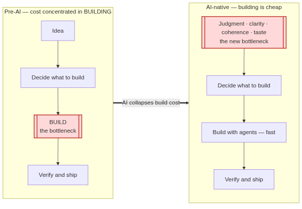
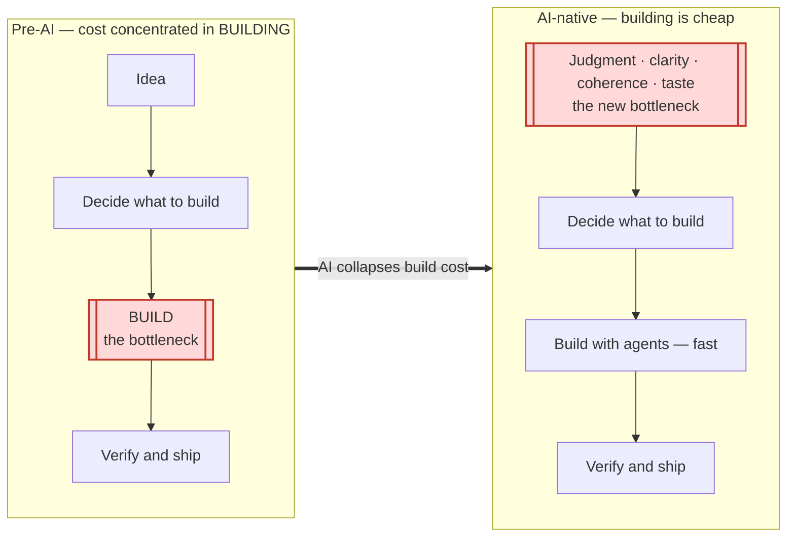
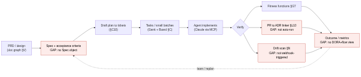
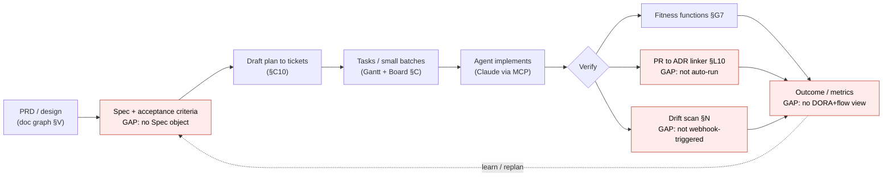
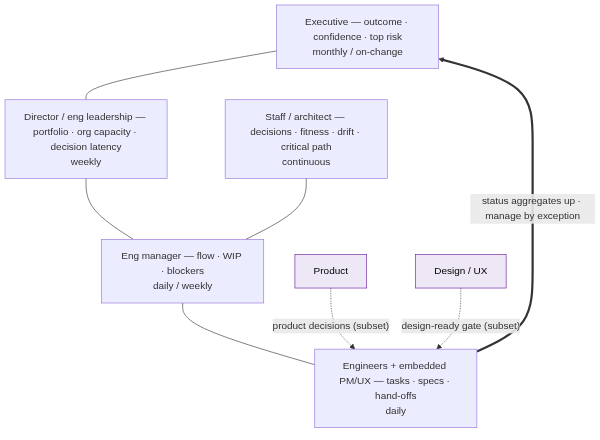
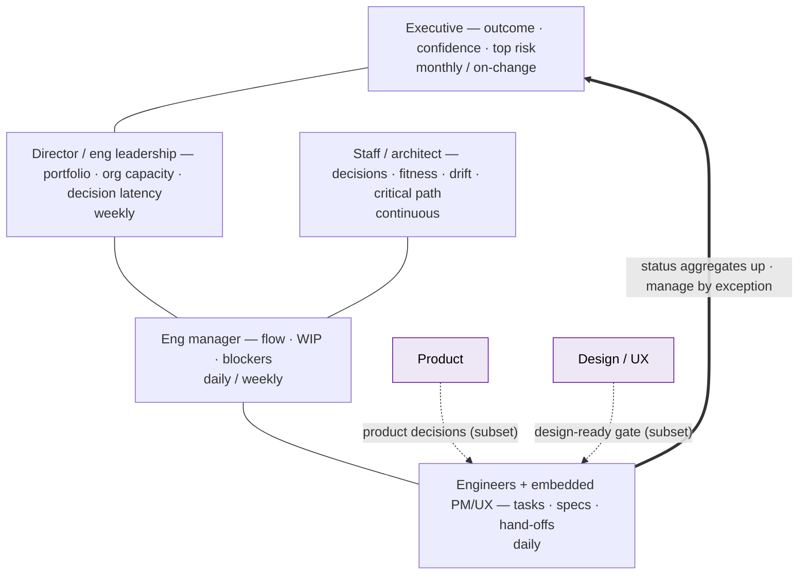
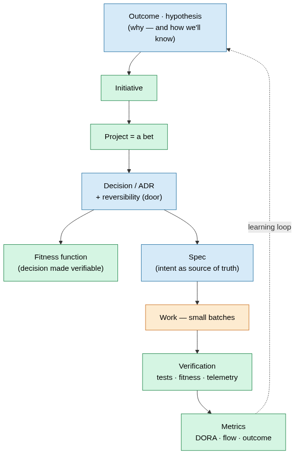
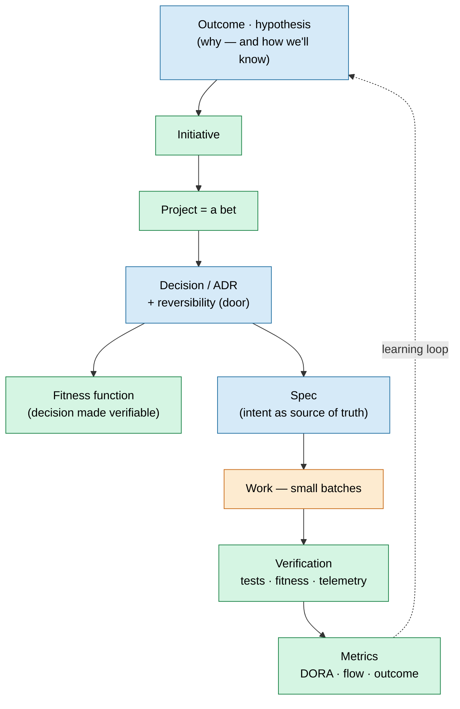
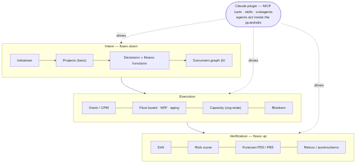
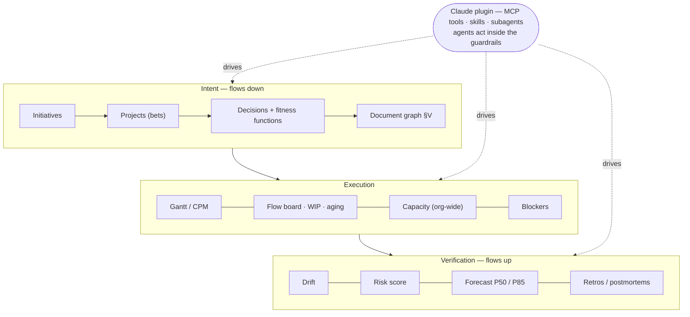

# Canopy as the Operating System for AI-Native Delivery

> **Vision document.** How fast-moving, highly agile teams execute effectively in the age of
> AI — grounded in current expert practice — and how Canopy becomes the internal tool that
> *operationalizes* that operating model. Companion to:
> - [`EXECUTION_PHILOSOPHY.md`](./EXECUTION_PHILOSOPHY.md) — the *why* (the delivery operating model).
> - [`PROPOSED_FLOWS.md`](./PROPOSED_FLOWS.md) — the *what* (proposed product changes).
> - [`USER_FLOWS.md`](./USER_FLOWS.md) — the source of truth for what is *built*.
>
> This doc connects the external expert consensus (2025–2026) to Canopy's existing spine and
> names the gaps worth closing. Where a gap maps to an existing proposal it is cited (`PF §X`).

---

## 0. Thesis

Across the most credible 2025–2026 sources — DORA's State of DevOps, DX's Core 4, Marty Cagan,
Will Larson, Neal Ford, Team Topologies, Addy Osmani, Kent Beck, Martin Fowler, Simon Willison —
one idea recurs with unusual unanimity:

> **AI collapses the cost of *building*. So the binding constraint moves *up* the stack — from
> execution to judgment, clarity, coherence, and product taste.**

Or, as the practitioners put it: *"AI helps you build the wrong thing with extraordinary
efficiency"* (DX); *"the bottleneck was understanding"* (Paulo André); *"taste is the new
bottleneck."* This is **exactly the bet Canopy already makes** — that the architect/PM's leverage
is in the *system that produces good decisions and verifies coherence*, not in personally doing
the work. The age of AI doesn't change Canopy's thesis; it **intensifies** it. As agents
increasingly write the code, the parts Canopy owns — intent, decisions, guardrails, verification,
outcomes, alignment — stop being nice-to-have dashboards and become the load-bearing structure.

---

## 1. The constraint shift

The evidence that the constraint really moved (not just that coding got faster):

- **Individual speedups are real but don't automatically become team throughput.** A
  GitHub/Microsoft RCT found developers completed a task **55% faster** with Copilot. Yet the
  **2024 DORA report** found a 25% rise in AI adoption correlated with a **~1.5% drop in delivery
  throughput and ~7.2% drop in delivery stability** — individual gains evaporated at the system
  level without small batches and strong testing. By Theory of Constraints, speeding a
  non-bottleneck step doesn't help; **"writing code has never been the bottleneck"** (DX).
- **The scarce resource is now judgment.** Cagan: as delivery cost collapses, *"the bottleneck
  and competitive advantage moves to product discovery,"* and the AI-accelerated project model is
  *"a turbo-charged feature factory… producing more bad products, faster."* Shreyas Doshi: *"AI
  commoditizes… the differentiator becomes the human judgment applied on top."*
- **Quality and coherence become first-order risks**, not afterthoughts. ~29% of Copilot-generated
  Python in one analysis contained security weaknesses; ~39% of practitioners report little/no
  trust in AI-generated code (DORA 2024). Simon Willison warns of **"cognitive debt"** — code
  that's clean and tested but *unowned and not understood*.

**Implication for Canopy:** the most valuable thing the tool can do is make the *upstream* work —
deciding what to build, recording why, and verifying it stays coherent — fast, visible, and
continuously checked. That is the spine below.

---

## 2. The operating model: centaur + spec-driven + small batches

The winning model is **centaur, not autopilot**: humans own problem definition, architecture, and
validation; agents own generation, enumeration, and pattern-matching at speed.

- **Intent is the source of truth — via specs.** Osmani: *"The root cause of AI agent failures is
  not the model… it was the spec."* Spec-driven development (GitHub Spec Kit; Thoughtworks Tech
  Radar) reframes *code-as-truth* → *intent-as-truth*: **Spec → Plan → Tasks → Implement**, with a
  validation checkpoint between phases and an agent **self-audit** against the spec's acceptance
  criteria before merge.
- **Small batches and short loops matter *more*, not less.** Kent Beck constrains the LLM (an
  *"unpredictable genie"*) with TDD and next-step-only context. The DORA finding above is the
  empirical proof: throughput gains only survive inside small batches + robust tests.
- **The human role inverts to Delegate → Review → Own** (OpenAI Codex's AI-native team guide):
  humans *"work at a different layer of abstraction — prioritizing, translating feedback into
  acceptance criteria, validating outcomes."* When an agent struggles, that's a signal to add the
  missing guardrail/doc and feed it back into the repo.

Canopy already has the *plan* half (draft plans → Jira, §C10) and the *verify* half (fitness
functions §G7, drift §N, PR-to-ADR linker §L10). The red nodes are the missing links — the
**Spec object**, auto-running the guardrails on agent output, and the **outcome/metrics** close
of the loop (see §7).

---

## 3. Coherence without a bottleneck

A decentralized, AI-augmented team cannot route every change through a human reviewer — that
turns the architect into the bottleneck and the loop goes long. The resolution is **guardrails,
not gates**: encode architectural intent as executable checks that run continuously.

- **Fitness functions** (Ford, Parsons & Kua, *Building Evolutionary Architectures*): *"any
  mechanism that provides an objective integrity assessment of some architectural characteristic."*
  O'Reilly's 2026 framing is blunt — *"deterministic guardrails around nondeterministic agents."*
  Agents verify *behavior* (tests) well but fail at *capability/coherence*; that's exactly what
  fitness functions guard.
- **Drift is the AI failure mode.** Each agent session is *locally* coherent (its tests pass) but
  *globally* erosive — logic lands where convenient, not where architecturally correct. Coherence
  must be **verified continuously, not declared once** (Mike Mason: *"coherence through
  orchestration, not autonomy"*).
- **Decisions decentralize by reversibility.** Bezos's two-way vs one-way doors: most decisions are
  reversible → decide fast, record, move; the few irreversible ones get friction. **Decision
  latency** is a tracked cost. Lightweight **ADRs** (Nygard; Fowler's *advice process*) capture the
  *why* so humans and agents share context.
- **Bounded agency for agents** (Skelton, Team Topologies @ QCon 2026): agents *"lose coherence
  when they operate outside their defined boundaries."* Give them **least-privilege, policy-bounded
  authority** — *"why would you give an agent write access you'd never give a human?"*
- **Accountability stays human** (Charity Majors): *"a computer can never be held accountable,
  therefore a computer must never make a management decision."* Navigators/staff engineers (Larson)
  keep coherence by getting context, not by gatekeeping.

**Canopy already models nearly all of this** — ADRs with `reversibility`, machine-checkable
fitness functions that fire as the heaviest drift signal, a drift queue, code bindings. The gaps
are *closing the loop automatically* and *bounding agent authority* (§7).

---

## 4. Measuring honestly (DORA + flow, not vanity)

> *"When a measure becomes a target, it ceases to be a good measure."* (Goodhart)

- **DORA four + rework rate.** Deploy frequency, lead time for change, change-fail rate, failed-
  deployment recovery time — the most validated delivery metrics in existence — plus the 2025
  **rework rate** for defect/unplanned-fix cost. The 2025 DORA report reframes AI as an
  **amplifier**: it *"magnifies existing strengths and dysfunctions,"* and throughput and stability
  *need not trade off* in well-engineered orgs. The seven **AI Capabilities** that unlock value
  include *small batch sizes, a user-centric focus, strong version control, AI-accessible internal
  data,* and *a high-quality internal platform.*
- **DX Core 4** (Noda, Tacho; Forsgren et al.): four **intentionally oppositional** dimensions —
  **Speed** (throughput), **Effectiveness** (Developer Experience Index), **Quality** (change-fail
  rate), **Impact** (% time on new capabilities). Explicit rule: **never use throughput metrics at
  the individual level or in performance reviews.**
- **Flow over utilization** (Kersten, *Project to Product*; Reinertsen): WIP, cycle time,
  throughput, and **flow efficiency** (typically a shocking **15–25%** — work waits 75–85% of the
  time). Manage queues and Cost of Delay, not busyness.
- **Lead with leading indicators.** **Aging WIP vs. the team's P85 cycle time** is the truest early
  predictor of a slip; **PR pickup/review latency** correlates most strongly with cycle-time loss;
  rising WIP predicts throughput decline *before* cycle time spikes. **Decision latency** and
  **blocked time** are the silent taxes.
- **Refuse the anti-metrics as targets:** velocity/story points as productivity, **lines of code**,
  **AI tokens or diffs per individual engineer** ("tokenmaxxing"), utilization %, any per-person
  ranking.

**Canopy has the inputs** (the §J8 activity substrate for deploys/failures/incidents, the flow
board's WIP + cycle-time-P85 aging §C9, the Monte-Carlo forecast §C8, blockers §D0) but **no
unified DORA + flow delivery surface** — the single biggest measurement gap (§7).

---

## 5. Alignment across stakeholders

For a 3–6 month initiative with 6–8 engineers plus staff, EMs, a director, execs, PM, and UX, the
enemies are **vertical translation loss** (exec sees green while a team is on fire) and **lateral
hand-off blindness** (team A learns it blocked team B at integration). The cure is one rule:
**one source of truth, rendered at many altitudes — derived, never re-keyed.** Status flows *up*
by aggregation; intent flows *down* the spine.

- **Outcomes over output** (Cagan): empowered teams are measured by outcomes, not a shipped
  roadmap. AI makes feature-factories *faster*, so the outcome anchor matters more.
- **The spec/PRD is the alignment artifact** across PM, design, and eng (Amazon's working-backwards
  PR-FAQ; Spec-Driven Development). Design/discovery is an **upstream dependency on a subset** of
  work — model it explicitly so a design slip's blast radius is visible immediately, not at
  integration. *(This is the doc graph §V + the PM/UX modeling from our stakeholder brainstorm.)*
- **Discovery keeps design + eng in sync** (Teresa Torres): triad ownership (PM + design + eng),
  small assumption tests *before* committing — *"most misalignment comes from discovering truth too
  late."*
- **Write, don't meet; manage by exception** (37signals: *"writing solidifies, chat dissolves"*).
  Green is silent; the digest leads with what's off-track and what needs a decision — **except**
  that silence ≠ safety (a project flying blind is flagged, not assumed green).
- **Leaders need signal, not vanity** — outcome dashboards + **confidence-based forecasting**
  (P50/P85, what-if) over narrative status. *"Learning speed is the moat."*

---

## 6. Canopy as the operating system

Putting it together: Canopy is where **intent flows down** and **verification flows up** the spine
for a decentralized, AI-augmented team — and where Claude (via the MCP plugin) **acts inside the
guardrails**. Velocity is how fast intent flows down; quality is how reliably verification flows
up. They are the same spine.

*(Blue = human owns the judgment; orange = agent executes; green = Canopy holds and verifies.)*

What each surface contributes, mapped to the operating model:

| Operating-model principle | Canopy surface (built) |
|---|---|
| Intent above the project | Initiatives + rollup + cross-project critical path (§R) |
| Decisions as first-class, with reversibility | ADRs: lifecycle, owner/stakeholders, one-/two-way doors, queue (§G) |
| Coherence verified continuously | Fitness functions (§G7) + drift detection + scan staleness (§N) |
| Probabilistic, honest forecasting | Monte-Carlo P50/P85, project + initiative (§C8) |
| Flow over utilization | Flow board: WIP + cycle-time-P85 aging (§C9); org-wide capacity (§F3) |
| Blocked time as the leading signal | Blockers, surfaced in `/me` + alerts (§D0) |
| Plan → tickets (content only; Jira owns status) | Draft plans → Jira create/update (§C10) |
| Link, don't store, the docs | Document graph + coverage + AI-driven epic mapping (§V) |
| Agents act, not just report | ~90-tool MCP surface + skills + subagents (§L) |

---

## 7. Where Canopy has a disconnect — the enhancement roadmap

The research **validates** most of `PROPOSED_FLOWS.md` and sharpens the AI-age priorities. The
through-line of every gap below: **close the spine's loop and make the agent a first-class,
*bounded* actor.**

| # | Gap (and the expert it traces to) | Canopy today | Enhancement | Priority |
|---|-----------------------------------|--------------|-------------|----------|
| 1 | **No first-class Spec / spec-driven loop.** "The spec is the bottleneck" (Osmani); intent-as-truth (Spec Kit, Thoughtworks). | ✅ **Shipped** — `Spec` + `SpecCriterion` (§W): problem + checkable acceptance criteria, `Task.spec_id`, and a `GET /specs/{id}` self-audit bundle with readiness; MCP `create_spec`/`add_spec_criterion`/`get_spec`/`update_spec_criterion`/`link_task_to_spec`; skill `spec-driven-development`. | **Done** |
| 2 | **No outcomes/hypothesis model.** Outcomes over output (Cagan, Torres, Cutler). `PF B-R3`. | ✅ **Shipped** — a first-class `Outcome` (§Y): hypothesis + success metric tracked baseline→target→current with a verdict; polymorphic on project/initiative; surfaced on both cockpits + folded into the retro seeder; MCP `list_outcomes`/`add_outcome`/`update_outcome`. | **Done** |
| 3 | **No DORA + flow delivery metrics.** DORA 2024/2025, DX Core 4, Flow Framework. `PF S`. | ✅ **Shipped** — `flow_metrics.py` (pure) + `GET /projects\|initiatives/{id}/delivery` (§X) + a **Delivery tab/panel** in the React cockpit: DORA (deploy freq, change-fail rate, recovery time) + flow (throughput, cycle time, WIP, aging); MCP `get_delivery_metrics`; **team-level only**. *Remaining:* rework rate / flow efficiency / PR-review latency (need more signal). | **Done** |
| 4 | **Agent guardrails not auto-wired + no bounded agency.** Fitness as guardrails (Ford); bounded agency (Skelton); accountability (Majors). `PF L-R3, N-R1`. | ◐ **Bounded agency shipped** — scoped `agent` tokens (`POST /auth/agent-token`, §A6) blocked from one-way-door / external-write actions (accept `one_way` ADR, push-to-jira, apply scenario); two-way doors open. *Remaining:* a webhook that auto-runs drift + PR-to-ADR + fitness on agent PRs (stays agent-driven — server can't crawl code, §N). | **Partly done** |
| 5 | **Decision→work→verification traceability + decision latency.** The spine (Larson, Nygard). `PF T, G-R4`. | Fitness shipped; no `Task.implements_adr_id`, no ledger, no latency metric. | `implements_adr_id` + a traceability view (ADR → tasks → PRs → fitness status) + decision-latency on the initiative cockpit. | **Med** |
| 6 | **No persona/role model + no pushed digests.** Vertical/lateral alignment (Cagan, 37signals, Cutler) + our brainstorm. `PF L-R2`. | ◐ **Mostly shipped** — a `User.function` persona layer (PM/UX/staff/director/exec, orthogonal to role) + per-persona landing (§A7); a manage-by-exception **initiative digest** (`/initiatives/{id}/digest`, §R5) + `daily-standup` skill + `get_initiative_digest`. *Remaining:* Slack/email **delivery** (a hook over the digest, like the alerts digest §I) and bespoke per-persona dashboards. | **Mostly done** |
| 7 | **AI doc generation/sync.** Natural next step of the doc graph (§V) + spec loop. | Doc graph links + coverage only. | Draft a **tech-design from PRD + ADRs**; keep the **architecture doc synced to reality** via the drift→ADR→PR loop. | **Med** |
| 8 | **No Definition-of-Done as policy.** Quality built-in (DORA, Fowler). `PF U`. | None. | Per-project DoD checklist (tests · ADR-if-significant · telemetry · docs · fitness pass), enforced softly at PR via the linker. | **Low–Med** |
| 9 | **Doc link-health + coverage-as-risk.** Absence of signal = risk (the §V follow-up). | `link_health` exists but stays `unchecked`; coverage not in the risk score. | A link-health sweep (HEAD/404) + fold the **doc-coverage gap** into the risk score's architecture/quality family. | **Low** |

**Suggested sequence:** (1) Spec object + spec-driven loop and (3) Delivery metrics are the
highest-leverage AI-native gaps — they close the two open ends of the spine (intent-in,
outcome-out). (4) Bounded agency + auto-guardrails is the governance prerequisite as agents do
more of the writing. (2) and (6) make the *outcome* and *alignment* halves real for the full
stakeholder set.

---

## 8. The one-line vision

> Canopy is the **operating system for AI-native delivery**: it keeps the intent spine **thin,
> explicit, and continuously verified**, so a small team — amplified by agents working *inside* its
> guardrails — can execute a large initiative concurrently, adapt with maximum agility, decide fast
> on the reversible and deliberately on the irreversible, and find out what's wrong while it's
> still cheap to fix.

---

## Sources

**Operating model & AI-native engineering**
- [My LLM coding workflow going into 2026 — Addy Osmani](https://addyosmani.com/blog/ai-coding-workflow/)
- [How to write a good spec for AI agents — O'Reilly Radar / Osmani](https://www.oreilly.com/radar/how-to-write-a-good-spec-for-ai-agents/)
- [Spec-driven development — Thoughtworks Technology Radar](https://www.thoughtworks.com/en-us/radar/techniques/spec-driven-development)
- [GitHub Spec Kit](https://github.com/github/spec-kit)
- [Building an AI-Native Engineering Team — OpenAI Codex](https://developers.openai.com/codex/guides/build-ai-native-engineering-team)
- [Augmented Coding: Beyond the Vibes — Kent Beck](https://tidyfirst.substack.com/p/augmented-coding-beyond-the-vibes)
- [Martin Fowler on AI's Nondeterministic Computing — The New Stack](https://thenewstack.io/martin-fowler-on-preparing-for-ais-nondeterministic-computing/)
- [Vibe coding and agentic engineering — Simon Willison](https://simonwillison.net/2026/May/6/vibe-coding-and-agentic-engineering/)
- [Revenge of the junior developer — Steve Yegge / Sourcegraph](https://sourcegraph.com/blog/revenge-of-the-junior-developer)

**Coherence, decisions & org design**
- [Building Evolutionary Architectures (fitness functions) — Ford, Parsons, Kua](https://www.oreilly.com/library/view/building-evolutionary-architectures/9781491986356/ch02.html)
- [Agents don't know what good looks like — O'Reilly Radar](https://www.oreilly.com/radar/agents-dont-know-what-good-looks-like-and-thats-exactly-the-problem/)
- [Team Topologies as 'Infrastructure for Agency' with AI — InfoQ / QCon 2026](https://www.infoq.com/news/2026/03/ai-agency-team-topologies/)
- [Navigators — Will Larson](https://lethain.com/navigators/) · [Engineering strategy — Will Larson](https://lethain.com/engineering-strategy/)
- [Architecture Decision Record — Martin Fowler](https://martinfowler.com/bliki/ArchitectureDecisionRecord.html) · [Scaling Architecture Conversationally](https://martinfowler.com/articles/scaling-architecture-conversationally.html)
- [AI Coding Agents in 2026: Coherence Through Orchestration — Mike Mason](https://mikemason.ca/writing/ai-coding-agents-jan-2026/)
- [DACI decision framework — Atlassian](https://www.atlassian.com/team-playbook/plays/daci)

**Metrics & flow**
- [DORA — Accelerate State of DevOps 2024](https://dora.dev/research/2024/dora-report/) · [Announcing the 2024 DORA report — Google Cloud](https://cloud.google.com/blog/products/devops-sre/announcing-the-2024-dora-report)
- [Google's 2025 DORA report](https://blog.google/innovation-and-ai/technology/developers-tools/dora-report-2025/) · [DORA AI Capabilities Model](https://cloud.google.com/blog/products/ai-machine-learning/from-adoption-to-impact-putting-the-dora-ai-capabilities-model-to-work) · [DORA 2025 analysis — RedMonk](https://redmonk.com/rstephens/2025/12/18/dora2025/)
- [Introducing the DX Core 4 — Abi Noda](https://newsletter.getdx.com/p/introducing-the-dx-core-4) · [Measuring productivity with DX Core 4](https://getdx.com/research/measuring-developer-productivity-with-the-dx-core-4/)
- [Quantifying GitHub Copilot's impact — GitHub Blog](https://github.blog/news-insights/research/research-quantifying-github-copilots-impact-on-developer-productivity-and-happiness/) · [arXiv 2302.06590](https://arxiv.org/abs/2302.06590)
- [Project to Product / Flow Metrics — Mik Kersten (Planview)](https://blog.planview.com/moving-from-project-to-product-with-flow-metrics-what-are-they-and-why-should-you-care/)
- [Goodhart's Law in engineering metrics — Axify](https://axify.io/blog/goodhart-law) · [Work Item Age — 55 Degrees](https://www.55degrees.se/blog/post/what-is-work-item-age)

**Product, UX & alignment**
- [Build to Learn vs Build to Earn — SVPG / Marty Cagan](https://www.svpg.com/build-to-learn-vs-build-to-earn/) · [AI Product Management 2 Years In — SVPG](https://www.svpg.com/ai-product-management-2-years-in/) · [Empowered Product Teams — SVPG](https://www.svpg.com/empowered-product-teams/)
- [Why Product Sense is the Only Skill That Will Matter — Shreyas Doshi](https://shreyasdoshi.substack.com/p/why-product-sense-is-the-only-product) · [How AI Will Impact Product Management — Lenny Rachitsky](https://www.lennysnewsletter.com/p/how-ai-will-impact-product-management)
- [The Faster You Go, the Wronger You Get — Paulo André](https://hagakure.substack.com/p/the-bottleneck-was-understanding) · [Taste Is the New Bottleneck — designative.info](https://www.designative.info/2026/02/01/taste-is-the-new-bottleneck-design-strategy-and-judgment-in-the-age-of-agents-and-vibe-coding/)
- [The 37signals Guide to Internal Communication](https://37signals.com/how-we-communicate) · [Amazon Working Backwards PR/FAQ](https://workingbackwards.com/concepts/working-backwards-pr-faq-process/)
- [Teresa Torres on AI Product Discovery](https://www.news.aakashg.com/p/teresa-torres-podcast) · [The Product Outcomes Formula — John Cutler](https://cutlefish.substack.com/p/tbm-4353-the-product-outcomes-formula)

---

*Authored as part of the stakeholder/initiative practices work. Promote roadmap items into
`PROPOSED_FLOWS.md` / `USER_FLOWS.md` as they ship, per `CLAUDE.md` → "Keeping USER_FLOWS.md in sync."*
