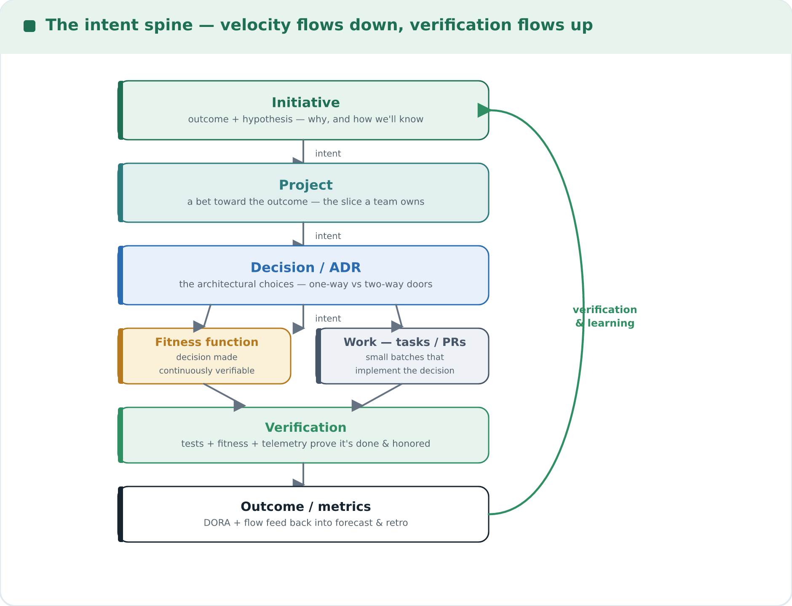
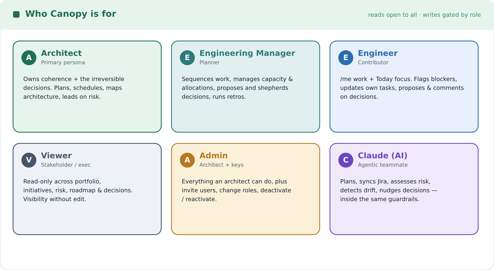
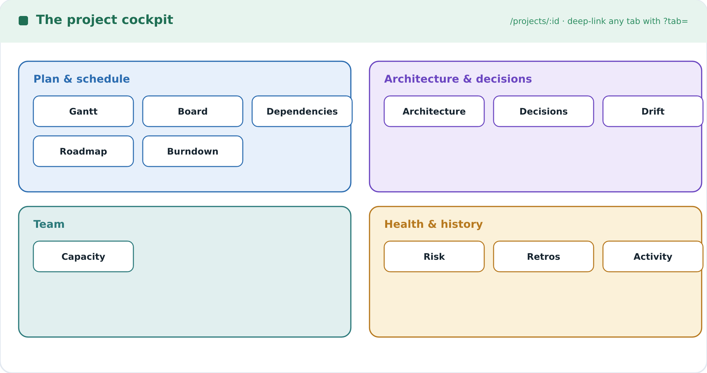
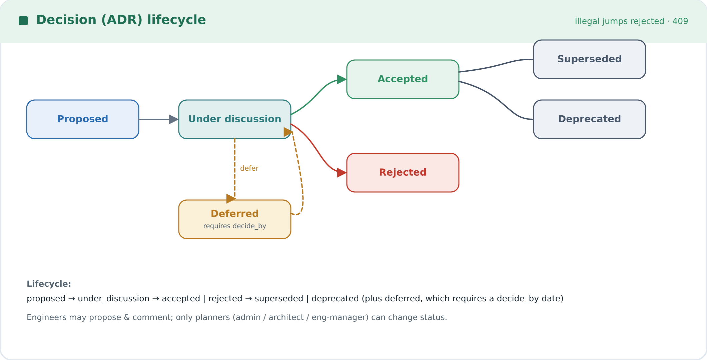
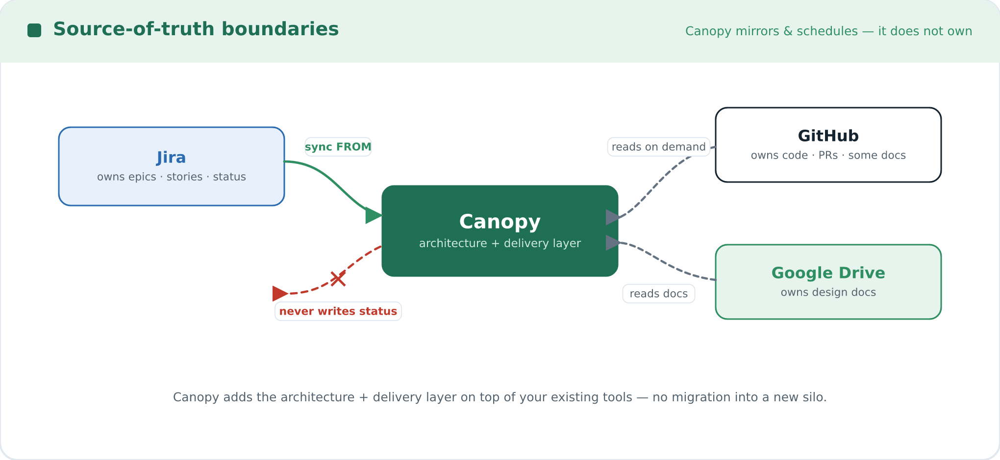

# Canopy — Now Available

> **Announcement:** Canopy is live. This page is the front door for everyone — architects, engineering
> managers, engineers, and anyone who just wants visibility. It explains *what* Canopy is, *who* it's
> for, *what* it does, and *how* to start using it today.

---

## TL;DR

**Canopy is the cockpit a technical architect uses to run the architecture *and* the delivery of a
codebase from one place.** Projects, milestones, WBS/Gantt scheduling with a real critical path,
teams and capacity, architecture maps, and architecture decisions (ADRs) — all kept honest against
your real systems of record by **syncing from Jira** and **reading from GitHub and Google Drive**.

It has **two front doors over one backend**:

- a **React dashboard** — the visual cockpit you click through, and
- a **Claude Code plugin** — an MCP server + skills + subagents that let you drive Canopy
  conversationally and let Claude do multi-step work on your behalf.


If you only remember one sentence: *Canopy connects the **intent** (initiatives → decisions → work)
to its **verification** (schedule, fitness functions, drift, risk) so a small team can execute a large
initiative concurrently and find out what's wrong while it's still cheap to fix.*

---

## Why Canopy exists

Most tooling makes you choose: a Gantt tool that knows nothing about your architecture, an ADR repo
that knows nothing about your schedule, a Jira board that knows nothing about either. The architect
is left stitching these together by hand — and the expensive failures all live *in the seams*: a
cross-team hand-off discovered at integration, an architectural decision made implicitly in a PR and
found six months later as drift, a decision stuck "under discussion" silently blocking five people.

Canopy's thesis is that **velocity and quality are the same lever — the length of your feedback
loops** — and that the architect's leverage is in *the system that makes good decisions happen
without them*, not in personally making every call. So Canopy keeps one traceable spine:



Intent flows *down*; verification and learning flow *up*. (The full operating model is in
[`EXECUTION_PHILOSOPHY.md`](./EXECUTION_PHILOSOPHY.md).)

---

## Who it's for — personas

Canopy supports five roles. **Reads are open to every authenticated user** (viewers included); writes
are gated by role (see the [permissions matrix](#roles--permissions)).



### The Architect (primary persona)
You own coherence and the expensive, hard-to-reverse decisions. Canopy is your daily cockpit:
- Run the **portfolio** and **initiative** roll-ups to see health across every project at a glance.
- Build the plan: WBS, dependencies, **critical path**, baselines, what-if staffing/scope analysis,
  and a **probabilistic (P50/P85) forecast** so "when does it ship?" is honest.
- Keep the architecture coherent: map components, record **ADRs**, attach **fitness functions**, and
  reconcile **drift** when code diverges from the declared design.
- Lead with **risk** (an opinionated 0–100 score with a drillable breakdown), not just lagging alerts.

### The Engineering Manager
A planner like the architect for delivery: create/sequence work, manage capacity and allocations,
propose and shepherd decisions, run retros. (Cannot manage users; that's admin-only.)

### The Engineer
A first-class citizen, not just a name on a card:
- **My work** (`/me`) shows your assigned open tasks (most-critical first) and the decisions you own
  or must review.
- **Today** (`/me/today`) is the daily focus: critical or due-soon tasks + decisions to push.
- **Flag blockers** on your tasks, **propose** and **comment on** ADRs, and update progress on the
  tasks assigned to you.

### The Viewer (stakeholder / exec)
Read-only access to everything — portfolio, initiatives, risk, roadmap, decisions. Perfect for
sponsors who need visibility without edit rights.

### The Admin
An architect with the keys to user management: invite users, change roles, deactivate/reactivate.

### Claude (your AI teammate)
Through the plugin, Claude acts on the architect's behalf: plans roadmaps, syncs Jira, assesses risk,
detects drift, nudges stuck decisions, and links PRs to the ADRs that govern them — all inside the
*same* guardrails as a human.

---

## The two front doors

### 1) The React dashboard
The visual cockpit. Sign in at `/login` and you land on the **Portfolio**. Top-level navigation:

| Page | What it's for |
|------|---------------|
| **Portfolio** (`/portfolio`) | Every project as a card: % complete, critical-task count, end date, **risk + drift** badges. |
| **Initiatives** (`/initiatives`) | The program layer above projects; each opens a rolled-up cockpit. |
| **Projects** (`/projects`) | Create projects, link them to initiatives. |
| **Project cockpit** (`/projects/:id`) | A tabbed workspace (see below). |
| **Team** (`/team`) | Engineers, roles, skills, and an **org-wide capacity** heatmap. |
| **Decisions** (`/decisions`) | The team-wide decision queue across all projects. |
| **Connectors** (`/connectors`) | Jira / GitHub / Google Drive connections (token or OAuth). |
| **My work** (`/me`, `/me/today`) | The engineer workspace. |
| **Admin → Users** (`/admin/users`) | User & role management (admins only). |

The **project cockpit** has these tabs: **Gantt · Board · Dependencies · Capacity · Decisions ·
Architecture · Drift · Roadmap · Burndown · Risk · Retros · Activity**. Any tab is deep-linkable with
`?tab=` (e.g. `/projects/12?tab=drift`).



### 2) The Claude Code plugin
Install the `canopy` plugin, point it at your Canopy URL, and paste a token. You then get **~61
curated MCP tools** (one per architect *intent*, not a 1:1 mirror of REST routes), plus:

- **6 skills** (runbooks): `planning-roadmaps`, `writing-adrs`, `syncing-jira`, `capacity-planning`,
  `decision-deadline-nudger`, `pr-to-adr-linker`.
- **4 subagents** (isolated multi-step work): `gantt-planner`, `jira-sync`, `risk-analyst`,
  `drift-sentinel`.

Both front doors call the **same REST API** (`/api/v1/...`), so anything you can click you can also
ask Claude to do — and vice-versa.

---

## Feature tour

### Initiatives & portfolio
- **Initiatives** group projects executed concurrently by a decentralized team and roll up their
  health: progress, **worst** sub-project risk and drift, open-decision backlog, latest end vs target,
  and a **P85 program forecast**.
- **Cross-project dependencies** model a hand-off between teams — allowed only within one initiative —
  and the initiative cockpit draws the **cross-project critical path** with hand-offs highlighted.
- The **portfolio** dashboard is the architect's morning glance: every project with its headline
  numbers and risk/drift badges, computed by the same scorers as the detail tabs.

### Planning & scheduling (Gantt)
- A **WBS** of tasks: `summary` tasks are phases/workstreams (tree via `parent_id`); leaf tasks are
  the Gantt unit. Dependencies are typed **FS / SS / FF / SF** with **lag**.
- **Critical Path Method** is computed backend-side over a DAG, honoring a working calendar
  (weekend-aware + project holidays). One click ("Schedule (CPM)") computes start/end, float, and
  `is_critical` for every task and flags **deadline violations** in red.
- **Baselines & schedule variance:** snapshot the plan-of-record (with a *reason*); the Gantt overlays
  current-vs-baseline as **variance**. Re-baselining is a deliberate, logged act — *re-planning is a
  feature, not a failure*. (The word "drift" is reserved for *architecture* drift.)
- **What-if scheduling:** test "what if we add an engineer / cut scope" with duration overrides —
  returns a projected end date and critical path **without persisting**.
- **Probabilistic forecast (Monte-Carlo):** **P50 (likely)** and **P85 (safe)** completion dates next
  to the deterministic CPM date, computed from the team's *actual* historical weekly throughput. No
  fake precision — it tells you when there isn't enough history yet.

### Flow board & blockers
- A **Kanban Board** groups leaf tasks into status lanes (from Jira-mirrored status) with **WIP** per
  lane, a client-side **WIP limit**, and **aging** cards highlighted when they sit in-status past the
  team's cycle-time P85 — the leading "this is stuck" signal.
- **Blockers** are flagged impediments any contributor can raise on a task; open blockers surface in
  the engineer workspace and the alerts digest.

### Team & capacity
- **Team** page: add engineers (title, GitHub login, timezone, committed hours/week, skill tags),
  define functional roles, and link an engineer to a login (which powers their `/me` workspace).
- **Capacity heatmap:** an engineer × ISO-week grid shaded by allocation %, **per project and
  org-wide** — so cross-project overload (50% on three projects = 150%) is visible where per-project
  views hide it.

### Architecture & decisions
- **Architecture map** (React Flow): components (service/module/datastore/external/ui) with typed
  relationships, plus per-component **owner / criticality / tier / observability URL**.
- **Decisions (ADRs)** are first-class, with a full lifecycle
  (`proposed → under_discussion → accepted | rejected → superseded | deprecated`, plus `deferred`
  which *requires* a decide-by date), an owner, stakeholders who review, **alternatives**, explicit
  **reversibility** (one-way / two-way door), and a discussion thread with formal review actions
  (approve / request changes / reject).

  
- **Decision queue:** team-wide and per-project, bucketed into *needs triage / stuck / deferred-soon /
  discussing* so nothing rots silently.
- **Blast radius:** for any ADR, the components it directly affects plus everything that transitively
  depends on them.
- **Import an ADR from a doc:** parse a markdown design doc in GitHub/Drive straight into an ADR.
- **Fitness functions** — the decision→verification spine: an accepted ADR can carry machine-checkable
  dependency rules (`forbid` / `require`) over the component graph; a violation becomes the heaviest
  **drift** signal and **auto-resolves** when the code is fixed. *An ADR connected to an executable
  check is a constraint; one that isn't is a wish.*

### Architecture drift detection
- A per-project **drift score** and **queue** catching where code has diverged from the declared
  architecture: unexpected/absent dependency edges, unimplemented accepted ADRs, implicit decisions
  (a new package/service/datastore with no ADR), and fitness-function violations.
- **Reconcile** each finding: **Accept → ADR**, **Reject → revert task**, or **False positive** (the
  detector learns the suppression). The **Drift Sentinel** subagent reads the code and posts
  observations; the server compares them to the declared map and maintains the queue.

### Risk (leading indicators)
- An opinionated **0–100 risk score** with four families — **Schedule, Capacity, Architecture,
  Quality** — each drillable to the offending tasks/decisions/engineer-weeks.
- A project with **no observability** is flagged as *flying blind* (low confidence), never silently
  scored as safer — absence of signal is risk, not health.
- A **risk timeline** (auto-captured nightly) so the trend is real, plus a **mitigation log** you can
  acknowledge with an owner and a check-in date. Lagging **alerts** (deadline misses, overdue
  milestones, over-allocations, open blockers) sit underneath.

### Retros & postmortems
- **Retrospectives** auto-seeded from project state (completed milestones, schedule variance, open
  drift, ADR churn) — editable, commentable, closable; mint a follow-up **task or ADR** so lessons
  become tracked work.
- **Postmortems** with a timeline/impact/root-cause/action-items template.

### Connectors & integrations
- **Jira** (token or OAuth): idempotent sync of epics→phases and stories→tasks, sprint tagging,
  status-history import (feeds burndown & forecast), and **auto-replan** when new tasks appear.
  *Jira owns status — Canopy never writes it back.*
- **GitHub** and **Google Drive**: read repo files, open PRs, and design docs on demand.
- **Webhooks** verify HMAC signatures before parsing and enqueue background jobs; a periodic poll
  reconciles as a backstop. A generic **CI/observability event** substrate (deploy / build failure /
  incident) feeds the quality-risk family and auto-opens a postmortem on an incident.

### Real-time
- While you're signed in, the dashboard streams change events (SSE) and refreshes views without a
  manual reload when someone replans or re-baselines.

### Claude plugin (agentic flows)
- **Plan a roadmap** (`planning-roadmaps` / `gantt-planner`): break down and sequence work, replan,
  and report the critical path and end date.
- **Sync Jira** (`syncing-jira` / `jira-sync`): find the connection, sync, reconcile the plan.
- **Write & shepherd decisions** (`writing-adrs`): draft, propose, transition, discuss, or import ADRs.
- **Plan capacity** (`capacity-planning`): cross-reference capacity, the critical path, and what-if.
- **Assess risk** (`risk-analyst`): lead with the risk breakdown, drill into burndown/critical path/
  decision queue, and log mitigations.
- **Detect drift** (`drift-sentinel`): read code, map imports to components, scan, and reconcile.
- **Nudge decisions** (`decision-deadline-nudger`) and **link PRs to ADRs** (`pr-to-adr-linker`).

---

## Getting started

### Architect quick start
1. **Sign in** at `/login` (your admin invites you; the first admin is seeded at startup).
2. **Create an initiative** (`/initiatives`) with an outcome statement and target date.
3. **Create a project** (`/projects`) and link it to the initiative.
4. **Connect Jira** (`/connectors`) and **Sync now** to import epics/stories as phases/tasks — this
   auto-replans the project.
5. Open the **Gantt** tab, add any missing tasks/dependencies, and click **Schedule (CPM)**.
6. **Set a baseline** so variance is tracked from here on.
7. Map your **Architecture**, record key **Decisions**, attach **fitness functions** to the
   irreversible ones, and add **code bindings** so the Drift Sentinel can do its job.
8. Make the **Risk** tab your daily surface.

### Engineer quick start
1. **Sign in** and open **My work** (`/me`). If nothing shows, ask an admin to link your login to
   your engineer record on the Team page.
2. Check **Today** (`/me/today`) for your critical/due-soon tasks and the decisions to push.
3. **Flag a blocker** the moment work stalls; **propose or comment** on decisions you care about.

### Run the whole stack (self-host)
```bash
cp .env.example .env
# set SECRET_KEY, TOKEN_ENCRYPTION_KEY, and superuser creds (see comments in the file)
docker compose up --build
```
- API: `http://localhost:8000` (`/docs` for OpenAPI, `/api/v1/health` for health)
- Web: `http://localhost:5173`
- Migrations and superuser seeding run automatically on start.

### Install the Claude plugin
Install the `canopy` plugin (cataloged by `.claude-plugin/marketplace.json`), then configure:
- `api_base_url` — e.g. `http://localhost:8000`
- `api_token` — a JWT from `POST /api/v1/auth/login`

Now ask Claude things like *"sync Jira and tell me what slipped"*, *"plan a roadmap for PLATFORM"*,
or *"what's my riskiest project and why?"*

---

## Source-of-truth boundaries (please read)

Canopy is deliberately **not** the system of record for everything. It mirrors and schedules around
your real sources:



- **Jira** owns epics/stories and ticket **status**. Canopy syncs *from* Jira and **never writes
  status back** — mirrored status on Canopy tasks is read-only.
- **GitHub** owns code (and some architecture docs). **Google Drive** holds design docs. Canopy
  **reads** these; it does not own them.

This is what keeps Canopy honest: it adds the architecture/delivery layer *on top of* your existing
tools instead of asking you to migrate into yet another silo.

---

## Roles & permissions

Reads are open to every authenticated user. Write access is enforced server-side:

| Capability | admin | architect | eng-manager | engineer | viewer |
|------------|:----:|:--------:|:-----------:|:--------:|:------:|
| Users (invite / role / activate) | rw | r | r | r | r |
| Project create / settings / holidays | rw | rw | r | r | r |
| Plan: tasks / deps / milestones / replan | rw | rw | rw | own task | r |
| Capacity: engineers / roles / allocation | rw | rw | rw | r | r |
| ADR propose / comment | rw | rw | rw | rw | r |
| ADR status transition / components | rw | rw | rw | r | r |
| Risk mitigations | rw | rw | rw | r | r |

*"Own task"* = an engineer may update only a task assigned to them (e.g. progress); the dashboard
hides controls a role can't use, and the server is the real gate (returns `403`).

---

## Honest limits & what's coming

Canopy is opinionated about *not* half-building things. A few notable deferrals (with rationale in
[`USER_FLOWS.md`](./USER_FLOWS.md)):

- **Slack/email delivery** of alerts and decision-SLA notifications — alerts are computed and shown
  today; delivery is a future hook.
- **OIDC/SSO + cookie-based tokens** — auth is a `Bearer` JWT for now.
- **Hours-based capacity** (interrupt budget, PTO→CPM, skill-fit) — allocation is percent-based today.
- **Server-side code crawl for drift** — the Drift Sentinel subagent does the reading; the server
  compares observations. Only Python import analysis is implemented so far.
- **GitHub PR-latency metrics** and a **DORA/flow metrics** view — the event inputs exist; the views
  don't yet.
- A few flows are **API/Claude-only** (no UI form yet): what-if scheduling, project rename/archive,
  holiday management.

---

## Where to go next

- **[`USER_FLOWS.md`](./USER_FLOWS.md)** — the exhaustive, always-in-sync catalog of every
  user-facing flow, with its UI path, REST endpoint, and MCP tool.
- **[`EXECUTION_PHILOSOPHY.md`](./EXECUTION_PHILOSOPHY.md)** — the operating model: why velocity and
  quality are the same lever.
- **[`PROPOSED_FLOWS.md`](./PROPOSED_FLOWS.md)** — where Canopy is headed next.
- **`README.md`** — developer setup, CI, and run instructions.
- **OpenAPI** — `http://localhost:8000/docs` once the backend is running.

Welcome aboard. Canopy turns the architect's scattered context into one cockpit — *visible,
traceable, and continuously verified*.
